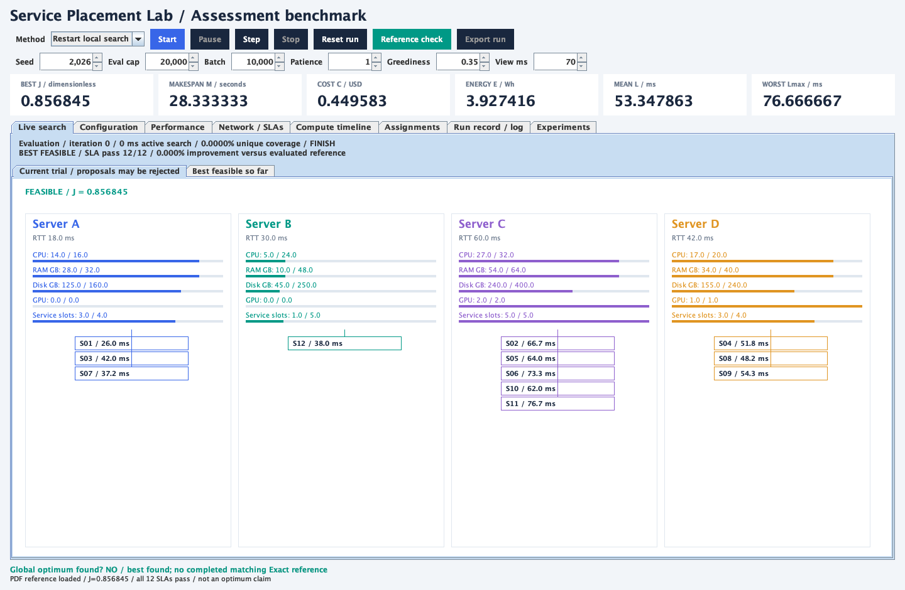
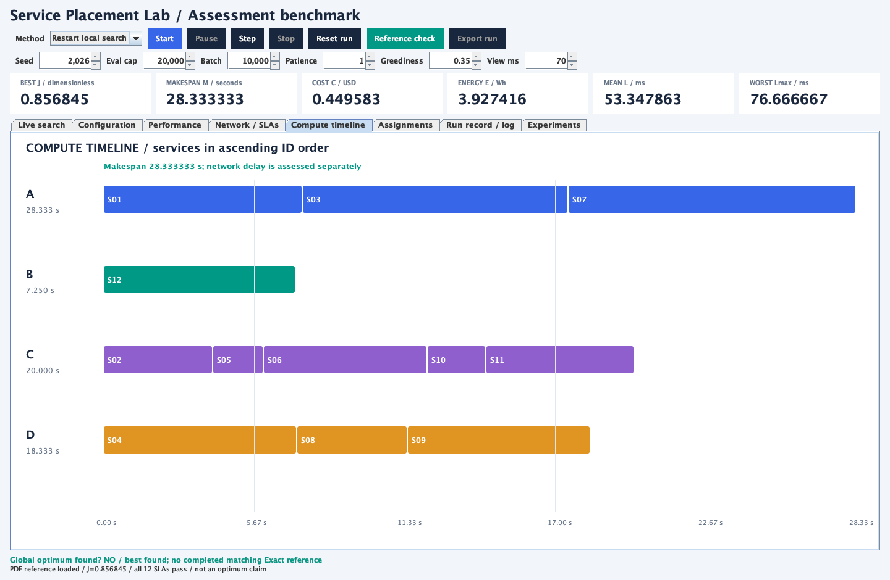

# Service Placement: assessment report

Java 17 / simplified implementation / 18 October 2026

## Problem and model

Place exactly 12 indivisible services on the four heterogeneous servers A-D. The fixed inputs from `requirements.pdf` are preloaded from `data/assessment/`, editable in Configuration and resettable. A candidate is a 12-entry integer vector: entry i selects the host of service i. There are 4^12 = 16,777,216 possible complete assignments.

Every accepted placement must satisfy CPU, RAM, disk, GPU-slot and maximum-service-count reservations on each server, and every service's communication SLA. There is no minimum service count per server. An invalid placement cannot compensate through a lower objective.

The evaluator implements the brief's equations:

- Busy time B[j] = sum of Work[i]/Speed[j] for services assigned to j, in seconds.
- Makespan M = max B[j]. The timeline executes services in ascending ID order.
- CPU utilization U[j] = reserved CPU / server CPU capacity.
- Active power P[j] = Idle[j] + (Peak[j]-Idle[j])*U[j], or zero for an empty server.
- Energy E = sum P[j]*B[j]/3600 Wh. Cost C = sum Price[j]*B[j] USD.
- Network latency = RTT[j] + 1000*8*PayloadMB[i]/BandwidthMbPerSec[j] ms.
- L is the mean network latency; Lmax is its maximum.
- Minimize J = 0.35*M/30 + 0.20*C/0.50 + 0.15*E/5 + 0.30*L/70.

The scales are normalizers, not hard limits. Network latency excludes compute and waiting time. Simulated seconds, network milliseconds and algorithm wall-clock time are separate quantities.

## Optimization and feasibility

The main method is restart local search with randomized greedy construction, a GRASP-style method. It ranks restricted services early, then randomly selects among promising compatible servers with enough remaining resources. Greediness determines the width of that choice. Every fifth construction allows the full compatible range to maintain exploration. Failed partial constructions are abandoned and counted separately; a bounded failure limit prevents endless reconstruction.

```text
best = none
while budget remains and not stopped:
    current = construct a resource- and SLA-compatible placement
    discard an unsuccessful partial construction
    evaluate current and update best if feasible and better
    repeat:
        evaluate moving each service to another server
        evaluate swapping pairs assigned to different servers
        select the best strict feasible improvement
        stop this descent if no neighbor improves
        current = selected improvement
    restart construction
return best feasible placement and stop reason
```

The evaluator checks every complete candidate. Only feasible candidates can replace the incumbent. Invalid and repeated complete evaluations consume budget; partial construction failures do not. The evaluation cap bounds search. Batch/patience optionally stop after consecutive batches without improvement; patience zero disables early stopping. Same inputs, seed and settings reproduce search results. Stop, Pause, Resume and Step control real evaluations.

Random samples complete host vectors and retains its best feasible placement. It is a transparent comparator, not the main optimizer. Exact enumerates every vector separately and never passes its answer to either approximate method. Only completed enumeration can prove an optimum or infeasibility; a heuristic failure is inconclusive. Aggregate resource shortages can also prove infeasibility early.

## Interface and verification

The application contains Configuration, Live search, Performance, Network/SLAs, Compute timeline, Assignments, Run record/log and Experiments. Current and best views use actual algorithm events. The UI samples early evaluations, improvements and periodic checkpoints; it does not display every fast evaluation. Resource figures are exact evaluated reservations. Animation moves service labels between real states. Charts show the best-J incumbent's J/L/M/E/C/Lmax, whose component measures may trade off even while J improves.





Automated T1-T12 cover default feasibility, S06 on non-GPU A, 21/16 CPU overload, disabling C GPUs, capacity equality, seed reproducibility, invalid speed/capacity, timeline totals, S03 on C violating its SLA, invalid network inputs, bandwidth sensitivity and reference arithmetic. Additional regressions check equal budget handling, Exact's optimum/feasible count, real pause/step/resume and stop while paused. The headless Swing worker test also checks 12 displayed network rows and saved charts. See `docs/evidence/self-test.log`.

The supplied reference mapping reproduces J=0.856845071161, M=28.333333 s, C=0.449583 USD, E=3.927416 Wh, L=53.347863 ms and Lmax=76.666667 ms, with 12/12 SLAs passing. It is a numerical self-check, not an optimum claim.

## Repeated experiments

Seeds 2026-2035, default assessment inputs, 20,000 complete evaluations for both local search and Random. Greediness=0.35; batch=10,000; patience is disabled to spend the same full budget. Method order alternates by seed to reduce fixed ordering effects. Exact runs once without a random seed. These results were generated from the simplified application; raw metrics, assignments, input snapshots and settings are in `results/assessment-study/`.

- **Exact verification**: 1/1 feasible; best J=0.715154360; mean J=0.715154360; sample SD=nan; mean search time=5094.00 ms.
- **Random baseline**: 10/10 feasible; best J=0.721231097; mean J=0.728570111; sample SD=0.006009098; mean search time=17.50 ms.
- **Restart local search**: 10/10 feasible; best J=0.715154360; mean J=0.716237309; sample SD=0.000380510; mean search time=15.30 ms.

Exact's single deterministic run has no sample standard deviation (NaN in CSV means undefined). It finds 92,643 feasible assignments and minimum J=0.7151543595803707. At the optimum M=18.5 s, C=0.444950980392 USD, E=3.684492442810 Wh, L=49.188034188034 ms and Lmax=76.666667 ms, with zero SLA violations. Local search matches Exact in 1/10 main runs; otherwise it returns best found. Its mean score is better than Random's at the same budget, but this is evidence for this instance and parameter setting only.


## Budget and network sensitivity

Other settings and seeds are fixed; patience is off. Budget runs use 20, 50, 100 and 200 evaluations. Network scenarios retain the main 20,000-evaluation budget.

- budget, budget 20: 10/10 feasible; mean J=0.759725669; mean L=52.3321 ms; mean Lmax=76.0000 ms.
- budget, budget 50: 10/10 feasible; mean J=0.757385980; mean L=52.2698 ms; mean Lmax=76.0000 ms.
- budget, budget 100: 10/10 feasible; mean J=0.740063501; mean L=51.1703 ms; mean Lmax=76.0000 ms.
- budget, budget 200: 10/10 feasible; mean J=0.732769681; mean L=51.3606 ms; mean Lmax=76.3333 ms.
- default, budget 20000: 10/10 feasible; mean J=0.716237309; mean L=48.8176 ms; mean Lmax=76.6667 ms.
- RTT_plus_25_percent, budget 20000: 10/10 feasible; mean J=0.763719590; mean L=57.0729 ms; mean Lmax=91.6667 ms.
- bandwidth_minus_30_percent, budget 20000: 10/10 feasible; mean J=0.735165882; mean L=55.3382 ms; mean Lmax=83.8095 ms.


Larger search budgets generally improve the mean solution here, at greater computational effort. Increasing RTT or reducing bandwidth raises communication latency and can exclude hosts through SLA thresholds. The three required GPU slots consume all available C/D GPUs, restricting those services. Faster processing can lower makespan while a higher price or power increases cost/energy, so the combined objective balances these effects.

## Limitations, reproducibility and credit

This is the specified static simulation: no congestion, packet loss, concurrent network transfers, replicas or physical deployment. Ten seeds give descriptive results, not a universal algorithm ranking. Timings depend on the JVM and host; deliberate display pacing and pauses are excluded. Headless Java 17 compilation, packaged-JAR tests, chart export and component rendering were verified on macOS; native interactive use and Windows scripts still need a manual smoke check. A live demonstration is required; the script in `docs/DEMO.md` does not establish that it has been delivered.

Reproduce with `./build.sh`, `./run.sh --self-test`, then `./run.sh --study 10 --out results/assessment-study`. The only runtime dependencies are Java's standard library, Swing and Java2D. The benchmark/formulas come from the supplied assessment brief. This project reuses the student's prior project and used AI coding assistance, including OpenAI Codex for simplification, tests and documentation. The student must review and explain the implementation and disclose assistance under institutional rules. The earlier implementation is preserved in `archive/previous-project.zip`; it is not part of the active build.
